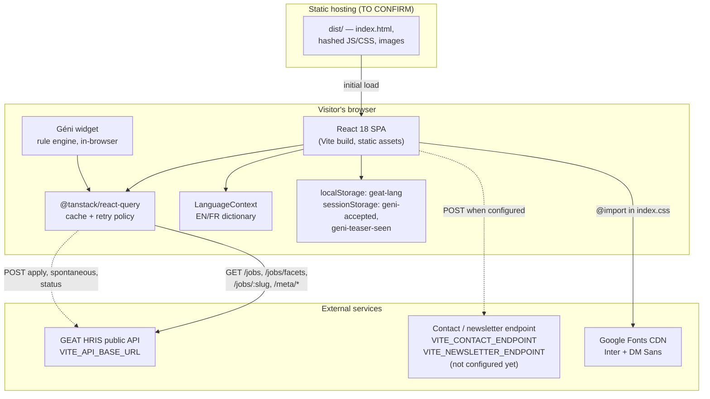
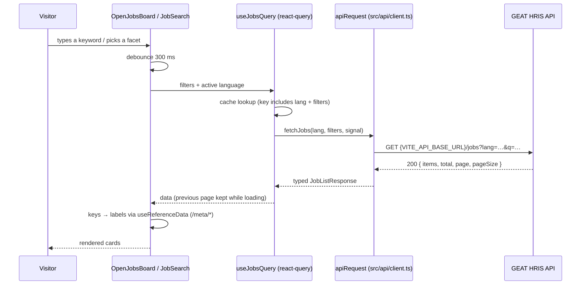
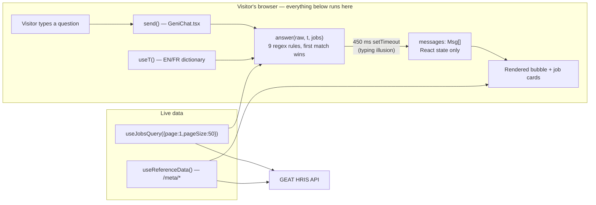
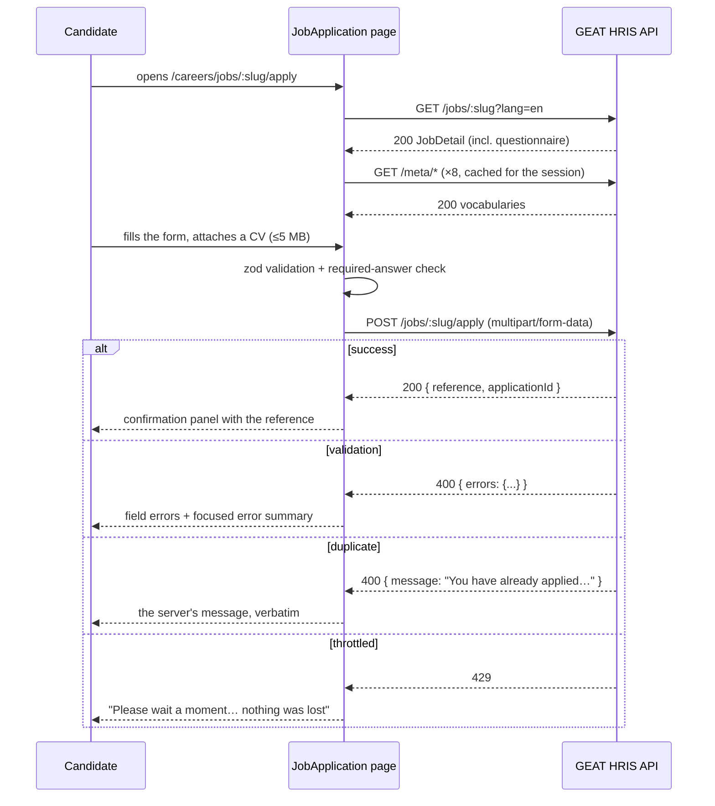
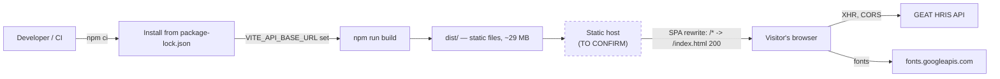

# GEAT Corporate Website — Technical & Handover Documentation

**Prepared for:** GEAT (General Electric Algeria Turbines) — technical owners and IT team
**Repository:** `https://github.com/Selmamakh/GEAT-website.git`
**Documents:** branch `main` as of this commit
**Date:** 2026-09-19

---

## Contents

1. [Project summary](#1-project-summary)
2. [Overview & architecture](#2-overview--architecture)
3. [Technology stack](#3-technology-stack)
4. [Project structure](#4-project-structure)
5. [Local setup](#5-local-setup)
6. [Configuration & environment variables](#6-configuration--environment-variables)
7. [Design system](#7-design-system)
8. [Géni — the careers assistant](#8-géni--the-careers-assistant)
9. [Newsletter & contact form](#9-newsletter--contact-form)
10. [APIs](#10-apis)
11. [Deployment](#11-deployment)
12. [Security](#12-security)
13. [Maintenance, known issues & tech debt](#13-maintenance-known-issues--tech-debt)
14. [Handover checklist](#14-handover-checklist)
15. [Appendix: what changed in this handover pass](#15-appendix-what-changed-in-this-handover-pass)

**Conventions.** Every claim is grounded in a file, and paths are relative to the repository root. **⚠️ TO CONFIRM** marks anything that could not be determined from the code; it always says what is missing and who is likely to know. Nothing has been inferred to fill a gap. **No secret values appear anywhere in this document** — only the names and locations of credentials that will be needed.

---

## 1. Project summary

The GEAT corporate website is a **static, client-rendered single-page application** built with React 18, TypeScript and Vite 5, styled with Tailwind CSS and shadcn/ui. It presents the company (about, leadership), its turbine product and service portfolio (nine detail pages), its news and milestones, and it runs the public recruitment funnel: a filterable job board, job detail pages, an application form with CV upload, a spontaneous-application form, and an application-status lookup. The site is bilingual (English / French).

There is **no back end in this repository**. Editorial content is authored in TypeScript modules under `src/data/` and `src/i18n/`; live recruitment data comes from one external service, the **GEAT HRIS public API**, addressed through an environment variable.

Two things differ from how the project is often described, and this document records the code as it is:

- **Géni is not an AI chatbot.** It is a deterministic keyword/regex rule engine running entirely in the browser. There is no AI provider, model, system prompt, RAG index, chatbot endpoint or API key. See [§8](#8-géni--the-careers-assistant).
- **The site sends no email.** The contact and newsletter forms are fully built and validated, and they POST to an endpoint that GEAT must configure. Until that endpoint exists they **fail visibly and say so** — see [§9](#9-newsletter--contact-form).

A companion document, **`UI-UX-GUIDELINES.md`** (1,664 lines), is the authoritative design-system reference and should be read before any visual change. **`README.md`** is the developer entry point.

---

## 2. Overview & architecture

### Purpose and scope

1. Present the company to utility, EPC and industrial buyers.
2. Merchandise the product and service portfolio.
3. Run the public recruitment funnel.
4. Publish news and milestones.

**Out of scope (not in this repository):** the GEAT HRIS API itself; any CMS (there is none — content changes are code changes); any authenticated area, admin console or database; any deployment or CI/CD configuration.

### Target users

| Audience | Primary destination |
|---|---|
| Utility, EPC and industrial buyers | `/products-services`, `/contact` |
| Job seekers (engineers, technicians, graduates) | `/careers/*` |
| Journalists and institutional partners | `/news`, `/about`, `/leadership` |

### Routes

Nineteen routes plus a catch-all 404, declared in `src/App.tsx`:

| Path | Page | Path | Page |
|---|---|---|---|
| `/` | `Index` | `/careers/fields/:slug` | `CareerField` |
| `/about` | `About` | `/careers/submit-cv` | `SpontaneousApplication` |
| `/leadership` | `Leadership` | `/news` | `News` |
| `/careers` | `Careers` | `/contact` | `Contact` |
| `/careers/jobs` | `JobSearch` | `/products-services` | `ProductsServices` |
| `/careers/jobs/:slug` | `JobDetails` | `/products-services/:slug` | `ProductDetail` |
| `/careers/jobs/:slug/apply` | `JobApplication` | `/privacy` | `Privacy` |
| `/careers/how-to-apply` | `HowToApply` | `/terms` | `Terms` |
| `/careers/life-at-geat` | `LifeAtGeat` | `/cookies` | `Cookies` |
| `/careers/faq` | `CareersFaq` | `*` | `NotFound` |

### Home page composition

`src/pages/Index.tsx` composes, in order: `HeroSlider` (3 autoplay slides), `AnnouncementsSection`, `WhoWeAre`, `ValuesScroll`, `WhatWeDo`, `StatsSection`, `EngineersSection`, `CareersSection`, `Newsletter`, `Footer`.

### Bilingual content

`src/i18n/LanguageContext.tsx` provides `t(englishSourceString)`, translating via a flat dictionary keyed on the English string (`src/i18n/fr/`, six modules). The choice persists to `localStorage` under `geat-lang` and sets `document.documentElement.lang`. The active language is part of every HRIS query key, so switching language refetches rather than serving stale data.

### Accessibility

Skip link, a site-wide focus ring that components may restyle but not remove, 44 px minimum pointer targets on coarse pointers, reduced-motion handling, accessible dialogs (`src/hooks/useDialog.ts`), and form error summaries that move focus. See §10 of `UI-UX-GUIDELINES.md`.

### System architecture



### Request flow for a live job list



---

## 3. Technology stack

Versions are the **resolved** versions from `package-lock.json` (lockfileVersion 3), not the semver ranges in `package.json`.

### Languages

| Language | Version | Evidence |
|---|---|---|
| TypeScript | 5.8.3 | `package-lock.json` |
| JavaScript (ESM) | — | config files only |
| CSS | — | `src/index.css` (810 lines) plus Tailwind |

TypeScript is configured **non-strict**: `strict: false`, `noImplicitAny: false`, `strictNullChecks` disabled, unused-checks off. Inherited from the scaffold; see [§13](#13-maintenance-known-issues--tech-debt).

### Framework and build

| Area | Technology | Version | Why |
|---|---|---|---|
| UI framework | React (`react`, `react-dom`) | 18.3.1 | The whole application |
| Build tool | Vite | 5.4.19 | Dev server (HMR) and production bundler |
| React plugin | `@vitejs/plugin-react-swc` | ^3.11.0 | SWC-based JSX transform |
| Routing | `react-router-dom` | 6.30.1 | `BrowserRouter` + 20 routes. **This is what forces the SPA-rewrite hosting rule** in [§11](#11-deployment) |
| Rendering | Client-side SPA | — | No SSR, no SSG, no server runtime |

**There is no Next.js in this project** — no server components, no API routes, no server actions.

### Styling and UI

| Library | Version | Why |
|---|---|---|
| `tailwindcss` | 3.4.17 | All layout and styling; tokens are CSS custom properties mapped into the theme |
| `postcss` + `autoprefixer` | 8.5.6 / ^10.4.21 | Tailwind's build pipeline |
| `tailwindcss-animate` | ^1.0.7 | Animation utilities for Radix-driven components |
| `@tailwindcss/typography` | ^0.5.16 | `prose` styling on rich-text job bodies — **registered** in `tailwind.config.ts` |
| shadcn/ui | vendored | 49 component files in `src/components/ui/`; config in `components.json` |
| `@radix-ui/react-*` | 24 packages | Accessible primitives under shadcn/ui |
| `class-variance-authority`, `clsx`, `tailwind-merge` | — | Variant and class composition; `cn()` in `src/lib/utils.ts` |
| `lucide-react` | ^0.462.0 | Icon set |

### Data, forms and validation

| Library | Version | Why |
|---|---|---|
| `@tanstack/react-query` | 5.83.0 | Every HRIS call: caching, cancellation via `AbortSignal`, custom retry policy, `placeholderData` so the board does not collapse to skeletons |
| `zod` | 3.25.76 | Client-side validation on every form |
| `dompurify` | 3.4.15 | **Security-relevant** — sanitises HRIS rich-text before `dangerouslySetInnerHTML`. See `src/lib/sanitizeHtml.ts` |
| `react-hook-form`, `@hookform/resolvers` | — | Peer deps of the vendored shadcn `form` primitive; **no application page uses them directly** |
| `sonner` | ^1.7.4 | Toast notifications |
| `next-themes` | ^0.3.0 | Required only by `src/components/ui/sonner.tsx`. The site has **no** light/dark toggle |

### Tooling

| Tool | Version | Command |
|---|---|---|
| ESLint | 9.32.0 | `npm run lint` — flat config, `typescript-eslint` 8, react-hooks, react-refresh |
| TypeScript | 5.8.3 | `npm run typecheck` — `tsc -b` |
| Vitest | 3.2.7 | `npm test` / `npm run test:watch` — jsdom, setup in `src/test/setup.ts` |
| Testing Library | ^16 / ^6.6 | Used by `src/test/legalPages.test.tsx` |
| Playwright | 1.62.1 | Configured in `playwright.config.ts`. **`e2e/` does not exist and there is no `test:e2e` script** — configured, not written |
| `axe-core` | ^4.13.0 | Installed for accessibility testing; **not yet referenced by any test** |

### Unused dependencies

The full shadcn/ui set is vendored but only ~15 primitives are imported. These are pulled in transitively by unused `src/components/ui/*` files, not by application code: `recharts`, `embla-carousel-react`, `cmdk`, `vaul`, `react-day-picker`, `input-otp`, `react-resizable-panels`, `date-fns`. Vite tree-shakes them out of the bundle.

### Package manager and Node

| Item | Value |
|---|---|
| Package manager | **npm** — `package-lock.json` (v3) is the only lockfile. Do not add a second |
| Node | **`>=20.0.0`**, pinned via `engines` in `package.json` and `.nvmrc` (`20`) |

### Repository layout note

The git repository is rooted at `GEAT-website/`. On the original development machine there is an outer `GEATWEBSITE/` folder containing a forwarder `package.json` whose scripts proxy with `npm --prefix GEAT-website run …`; that file is **outside the repository** and is not part of the deliverable. This is **not a monorepo** — no `workspaces` field, one lockfile, one application.

---

## 4. Project structure

```text
GEAT-website/
├── .env                            # Local, git-ignored
├── .env.example                    # Committed template — the three env vars, documented
├── .nvmrc                          # Node 20
├── .gitignore                      # node_modules, dist, .env, *.tsbuildinfo, editor dirs
├── README.md                       # Developer entry point
├── handover.md                     # THIS DOCUMENT
├── UI-UX-GUIDELINES.md             # 1,664-line design-system reference
├── index.html                      # Entry HTML: title, meta, Open Graph, Twitter cards
├── components.json                 # shadcn/ui CLI config
├── vite.config.ts                  # Dev server port 8080, @ -> ./src alias, react dedupe
├── vitest.config.ts                # jsdom, globals, setup file
├── playwright.config.ts            # E2E config. testDir "./e2e" — DOES NOT EXIST YET
├── playwright-fixture.ts           # Re-exports Playwright base test/expect
├── tailwind.config.ts              # CSS custom properties -> Tailwind theme
├── postcss.config.js               # tailwindcss + autoprefixer
├── eslint.config.js                # ESLint 9 flat config
├── tsconfig*.json                  # Project references (non-strict)
├── package.json / package-lock.json
│
├── public/                         # Copied verbatim into dist/
│   ├── favicon.png
│   └── robots.txt                  # Allows all crawlers; nothing disallowed
│
└── src/
    ├── main.tsx                    # Installs the image fallback, mounts App on #root
    ├── App.tsx                     # Provider stack + route table
    ├── index.css                   # Google Fonts import, design tokens, base layer,
    │                               #   component classes, utilities
    │
    ├── api/                        # The ONLY place that talks to the network
    │   ├── client.ts               # fetch wrapper; ApiError with 6 kinds; retryPolicy
    │   ├── jobs.ts                 # One function per HRIS endpoint
    │   ├── forms.ts                # Contact + newsletter submission (configurable)
    │   └── types.ts                # Response shapes, transcribed from the HRIS server
    │
    ├── hooks/
    │   ├── useJobs.ts              # useJobsQuery, useJobFacetsQuery, useJobQuery,
    │   │                           #   useJobCountByDepartments
    │   ├── useReferenceData.ts     # Fetches all 8 meta vocabularies once per session
    │   ├── useDialog.ts            # Escape (topmost only), focus trap, scroll lock
    │   ├── use-mobile.tsx  use-reveal.ts  use-toast.ts
    │
    ├── lib/
    │   ├── utils.ts                # cn() — clsx + tailwind-merge
    │   ├── sanitizeHtml.ts         # DOMPurify allow-list + safeExternalUrl. SECURITY
    │   ├── apiErrors.ts            # ApiError kind -> user-facing title/description
    │   └── imageFallback.ts        # Marks failed images; index.css paints a panel
    │
    ├── i18n/
    │   ├── LanguageContext.tsx     # LanguageProvider, useLanguage, useT
    │   ├── fr.ts                   # Merges the six dictionaries into one flat map
    │   └── fr/  common · home · careers · products · pages · legal
    │
    ├── data/                       # Editorial content as TypeScript. No CMS.
    │   ├── careers.ts              # GEAT_OFFERS, careerFields, careersFaqs,
    │   │                           #   careerFieldDepartments, formatDate()
    │   └── products.ts             # psImages, nine ProductEntry records, psCategories
    │
    ├── pages/                      # One component per route (20 files)
    │   ├── Index · About · Leadership · News · Contact · NotFound
    │   ├── ProductsServices · ProductDetail
    │   ├── Careers · JobSearch · JobDetails · JobApplication
    │   │   SpontaneousApplication · HowToApply · LifeAtGeat · CareersFaq · CareerField
    │   └── LegalPage (shared shell) · Privacy · Terms · Cookies
    │
    ├── components/                 # 27 application components
    │   ├── Navbar · Footer · PageHero · Breadcrumb · NavLink · ScrollToTop
    │   ├── HeroSlider · heroStyles.ts · floatingWidgetLane.ts
    │   ├── GeniChat.tsx            # The careers assistant — see §8
    │   ├── OpenJobsBoard.tsx       # Filterable, paginated, API-backed job board
    │   ├── ApplicationStatusModal.tsx  # Opened by the "geat:application-status" event
    │   ├── QuestionnaireFields.tsx · FormField.tsx
    │   ├── Newsletter.tsx          # Subscription panel — see §9
    │   ├── AnnouncementsSection · WhoWeAre · WhatWeDo · OurValues · ValuesScroll
    │   ├── StatsSection · CountUpValue · EngineersSection · RevealOnScroll
    │   ├── CareersSection · CareersPurpose · CareersSubNav · RecruitmentTimeline
    │   ├── KickerLabel · LanguageSwitcher
    │   └── ui/                     # 49 vendored shadcn/ui primitives (~15 in use)
    │
    ├── assets/                     # ~100 images imported by Vite (hashed, bundled)
    │   └── ps/{auxiliary,repair}/  # Product & service imagery
    │
    └── test/
        ├── setup.ts                # jest-dom, window.matchMedia stub
        ├── example.test.ts         # Placeholder assertion
        └── legalPages.test.tsx     # 6 render/содержание tests for the legal pages
```

### Where to find things

| I need to change… | Go to |
|---|---|
| A route | `src/App.tsx` |
| Page copy (English) | The page/component itself — English is the source language |
| A French translation | The matching file in `src/i18n/fr/` |
| A product or service page | `src/data/products.ts` |
| Career-field narratives, FAQ, benefits list | `src/data/careers.ts` |
| A colour, spacing or font token | `src/index.css`, then `tailwind.config.ts` |
| A job posting | **Not here** — the HRIS back office |
| Géni's answers | `src/components/GeniChat.tsx`, the `answer()` function |
| Anything network-related | `src/api/` — no `fetch` exists anywhere else in `src/` |

### Import alias

`@/*` resolves to `src/*`, declared three times and kept in sync: `vite.config.ts`, `tsconfig.app.json`, `vitest.config.ts`. Changing it requires editing all three.

---

## 5. Local setup

### Prerequisites

| Requirement | Detail |
|---|---|
| **Node.js** | **20 LTS or newer** — enforced by `engines` and `.nvmrc`. With nvm: `nvm use` |
| **Package manager** | **npm.** `package-lock.json` (v3) is the only lockfile |
| **Git** | To clone from `https://github.com/Selmamakh/GEAT-website.git` |
| **The GEAT HRIS API** | Required for careers pages to show data. Without it the site loads and the corporate pages work; careers pages show their network-error states |

No database, no Docker, no other local service.

### Install and configure

```bash
git clone https://github.com/Selmamakh/GEAT-website.git
cd GEAT-website
nvm use            # optional, reads .nvmrc
npm install
cp .env.example .env
```

Point `VITE_API_BASE_URL` at whichever HRIS instance you develop against. Full details in [§6](#6-configuration--environment-variables).

### Commands

| Command | What it does |
|---|---|
| `npm run dev` | Vite dev server with HMR on **http://localhost:8080** (host `::`). HMR error overlay is disabled |
| `npm run build` | Production build into `dist/` |
| `npm run build:dev` | Build with Vite's `development` mode |
| `npm run preview` | Serve the existing `dist/` locally |
| `npm run lint` | ESLint across the project |
| `npm run typecheck` | `tsc -b` |
| `npm test` | Vitest, single run |
| `npm run test:watch` | Vitest in watch mode |

There is still **no `test:e2e` script** — Playwright has no tests yet.

### Running end to end

```bash
# 1. Start the GEAT HRIS API on the URL in your .env
npm run dev
# 2. Open http://localhost:8080
```

Smoke path:

1. `/` — hero slider autoplays; announcements, stats and careers bands render.
2. Switch language — the site flips to French and survives a reload.
3. `/careers/jobs` — live postings, filter counts and pagination from the API.
4. Open a posting → **Apply** → submit with a small PDF. A server-issued reference appears.
5. On any `/careers/*` page, open **Check Application Status** with that reference and email.
6. Click the Géni bubble → accept → ask "what jobs are available?" — real postings with working links.
7. `/privacy`, `/terms`, `/cookies` render.
8. Submit the newsletter or contact form — with no endpoint configured, both show *"This form is not available yet"* and point at `contact@geat.dz`. **That is the correct behaviour**, not a bug.

### Gotchas

- **Port 8080 is not arbitrary** — the HRIS CORS allow-list is pinned to it. Changing the dev port breaks every API call.
- **The HMR overlay is off** (`vite.config.ts`), so runtime errors appear only in the browser console.
- **TypeScript is non-strict** — the compiler will not catch null-safety mistakes.
- **`react` is force-deduped** in `vite.config.ts`. A dependency bundling its own React copy will cause hook errors until the dedupe list covers it.

---

## 6. Configuration & environment variables

Established by grepping the whole repository for `import.meta.env` and `process.env`. Exhaustive.

### Application variables

| Name | Required? | Purpose | Used by | Client-exposed? | Example / placeholder |
|---|---|---|---|---|---|
| `VITE_API_BASE_URL` | **Effectively yes** (has a silent fallback) | Base URL of the GEAT HRIS public API | `src/api/client.ts`, consumed by every function in `src/api/jobs.ts` | **YES** — Vite inlines it into the bundle at build time | `http://localhost:4000/api` (dev) · `https://hris.example.geat.dz/api` (prod placeholder) |
| `VITE_CONTACT_ENDPOINT` | No | Full URL receiving contact-form submissions (JSON POST) | `src/api/forms.ts` → `src/pages/Contact.tsx` | **YES** | `https://hris.example.geat.dz/api/contact` |
| `VITE_NEWSLETTER_ENDPOINT` | No | Full URL receiving newsletter subscriptions (JSON POST) | `src/api/forms.ts` → `src/components/Newsletter.tsx` | **YES** | `https://hris.example.geat.dz/api/newsletter/subscribe` |

**When `VITE_API_BASE_URL` is unset**, the code falls back to `http://localhost:4000/api`. In a production build that fallback is **silent** — the site deploys, corporate pages work, and every careers page shows "Connection problem".

**When the two form endpoints are empty**, each form tells the visitor online submission is not active yet and points them at `contact@geat.dz`. It does **not** fake success.

None of the three is a secret: the HRIS API is public and unauthenticated by design, and the form endpoints are write-only receivers. **No credential exists anywhere in this repository.**

### Build/CI variables

| Name | Required? | Purpose | Used by | Client-exposed? |
|---|---|---|---|---|
| `CI` | No | Standard CI flag — Playwright forbids `test.only`, retries twice, does not reuse a dev server | `playwright.config.ts` | No — Node-side only |

### Variables that do not exist

There is **no** AI/LLM provider key, model name, ESP credential, analytics ID, error-tracking DSN, reCAPTCHA key, database URL or session secret anywhere — not in code, not in `.env`, not in `.env.example`.

### The rule that must survive this handover

Vite exposes only **`VITE_`**-prefixed variables to browser code, and **this is a purely client-side SPA with no server runtime** — so there is no "server-only" tier at all. **Any secret introduced later cannot be held by this application; it must live behind an API.** This is the single most important configuration constraint. See [§12](#12-security).

### Configuration files

| File | Controls | Notable contents |
|---|---|---|
| `package.json` | Scripts, dependencies | 8 scripts; 45 runtime + 25 dev deps; `engines: node >=20` |
| `package-lock.json` | Exact versions | npm lockfile v3 |
| `vite.config.ts` | Dev server, bundler | Port **8080**, host `::`, HMR overlay off, `@` → `./src`, React deduped |
| `vitest.config.ts` | Unit tests | jsdom, globals, `src/test/setup.ts` |
| `playwright.config.ts` | E2E | `testDir: "./e2e"` (missing), `baseURL: :8080`, chromium, auto-starts dev server |
| `tailwind.config.ts` | Tokens → utilities | `darkMode: ["class"]`, content globs, fonts, colour map, radii, keyframes. Plugins: `tailwindcss-animate`, `@tailwindcss/typography` |
| `postcss.config.js` | CSS pipeline | tailwindcss + autoprefixer |
| `components.json` | shadcn/ui CLI | `style: default`, `rsc: false`, `baseColor: slate`, `cssVariables: true` |
| `tsconfig*.json` | TS compilation | **Non-strict**; `include: ["src"]`, `target: ES2020`, `moduleResolution: bundler` |
| `eslint.config.js` | Linting | Flat config. **`@typescript-eslint/no-unused-vars` is off** |
| `.gitignore` | VCS | `node_modules`, `dist`, `.env`, `.env.local`, `*.tsbuildinfo` |
| `index.html` | Document head | Title, description, favicon, OG and Twitter tags. **Hard-codes `https://www.geat.dz/`** |
| `public/robots.txt` | Crawlers | Allows everything |
| `.nvmrc` | Node version | `20` |

### Hard-coded values

| Value | Location | Note |
|---|---|---|
| API fallback `http://localhost:4000/api` | `src/api/client.ts` | Applies whenever the env var is unset, including in production |
| Dev port `8080` | `vite.config.ts` | Must match the HRIS CORS allow-list |
| Canonical URL `https://www.geat.dz/` | `index.html` | ⚠️ **TO CONFIRM** this is the production domain |
| `contact@geat.dz`, `recruitment@geat.dz`, `+213 033 27 81 11` | `src/pages/Contact.tsx`, `src/components/Footer.tsx` | Editorial content |
| LinkedIn `https://www.linkedin.com/`, jobs `https://emploitic.com/` | `src/components/Footer.tsx` | The LinkedIn URL is a **placeholder** pointing at LinkedIn's home page |
| Google Fonts import | `src/index.css:1` | Inter + DM Sans, loaded at runtime |
| Storage keys `geat-lang`, `geni-accepted`, `geni-teaser-seen` | `LanguageContext.tsx`, `GeniChat.tsx` | Browser storage only |

---

## 7. Design system

The authoritative reference is **`UI-UX-GUIDELINES.md`** (13 sections). Read it before any visual change. This section summarises it.

### Where it lives

| Layer | File |
|---|---|
| Tokens | `src/index.css` — `:root` and `.surface-dark` |
| Token → utility mapping | `tailwind.config.ts` |
| Reusable classes | `src/index.css` `@layer components` / `@layer utilities` |
| Primitives | `src/components/ui/` (49 vendored shadcn/ui files) |
| Written rules | `UI-UX-GUIDELINES.md` |

### Fonts

Loaded from the Google Fonts CDN at `src/index.css:1`.

| Family | Class | Weights | Used for |
|---|---|---|---|
| **DM Sans** | `font-heading` | 300–800 + italic 400 | Headings, buttons, eyebrows, nav |
| **Inter** | `font-body` | 300–700 | Body copy (applied to `<body>`) |

`h1`–`h6` get `font-heading` automatically from a base-layer rule.

### Colour

All colour is **HSL channel triplets in CSS custom properties**, consumed as `hsl(var(--token))`. **Never hard-code a hex or `hsl()` literal.**

**Brand layer** — fixed identity values, sampled from `src/assets/geat-logo.png`:

| Token | HSL | Hex | Role |
|---|---|---|---|
| `--geat-dark` | `215 30% 16%` | `#1D2735` | Navy ground for heroes, footer, stat bands |
| `--geat-orange` | `32 100% 54%` | `#FF9013` | Logo amber — fills and ornaments |
| `--geat-orange-dark` | `32 100% 38%` | `#C26700` | Amber as a **border** on white (3.74:1) |
| `--geat-blue` | `200 98% 32%` | `#026CA2` | Logo hue, clears 4.5:1 on light grounds |
| `--geat-blue-light` | `200 90% 62%` | `#47BBF5` | Blue legible on navy (6.96:1) |
| `--geat-light` | `216 20% 96%` | — | Light neutral |

**Semantic layer** — surface-aware. `:root` defines light grounds; adding **`surface-dark`** to a container redefines them for navy, and children keep the same class names:

```tsx
<section className="surface-dark section-y bg-geat-dark">
  <h2 className="text-foreground">Numbers</h2>
  <p className="text-muted-foreground">…</p>
</section>
```

There is deliberately **no site-wide light/dark theme**. `darkMode: ["class"]` is set and `next-themes` is installed, but nothing adds `.dark` and there are no `dark:` variants.

> **The rule that is easiest to break: orange is not a text colour on light grounds.**
> `--primary` on a light ground is a **fill/ornament token only** — buttons, rules, decorative marks. No saturated orange reaches 4.5:1 on a near-white page. Inside `.surface-dark`, `text-primary` *is* real orange text (6.64:1).
>
> | Was orange text | Use |
> |---|---|
> | Eyebrows / meta | `text-muted-foreground` (5.61:1) |
> | Inline prose links | `text-accent` — logo blue (4.96:1) |
> | CTA-style links | `text-foreground` + amber arrow glyph |
> | Required asterisks | `text-destructive` |

**The brand-fill triplet** — the button fill is its own token, decoupled from `--primary`, because a fill is a surface whose label supplies the contrast:

| Token | Tailwind | Value |
|---|---|---|
| `--brand-fill` | `bg-brand` | `var(--geat-orange)` |
| `--brand-fill-foreground` | `text-brand-foreground` | `var(--geat-dark)` — 6.64:1 |
| `--brand-fill-edge` | `border-brand-edge`, `--ring` | `32 100% 38%` — 3.74:1 rim (WCAG 1.4.11) |

### Spacing

| Token | Class | Mobile / ≥640 / ≥1024 | Use |
|---|---|---|---|
| `--space-section` | `.section-y-sm` | 40 / 56 / 64 px | Tight bands, sub-navs, CTA strips |
| `--space-section-sm` | `.section-y` | 56 / 80 / 96 px | The default |
| `--space-section-lg` | `.section-y-lg` | 72 / 96 / 128 px | Opening statements, closing CTAs |
| — | `.section-head` | 32 / 40 / 48 px | Gap below a heading block |
| `--tap` | `.tap-target` | 44 px | Minimum pointer target (WCAG 2.5.8) |

Horizontal gutter: `.section-container` = `max-w-[1400px] mx-auto px-5 sm:px-6 lg:px-12`.

The header is `position: fixed`, so `body` carries `padding-top: 4rem` (5rem ≥1024px). **Keep this in lockstep with the header's `h-16 lg:h-20`** — do not re-solve it with spacer `<div>`s.

### Radius and elevation

All radii derive from `--radius: 0.5rem`. Below 768 px, `.rounded-2xl` softens to 0.875rem. Elevation uses Tailwind's default shadow scale; bespoke shadows reference tokens.

### Component conventions

- **One owner per pattern** — eyebrows are `KickerLabel`; heroes are `PageHero`/`HeroSlider` with shared geometry in `heroStyles.ts`; floating widgets share a lane via `floatingWidgetLane.ts`.
- **Class merging goes through `cn()`** so a caller's `className` wins.
- **Focus is a floor** — `:focus-visible` gets a 2 px ring. Components may restyle it; nothing may remove it.
- **Pointer targets** use `:where()` (zero specificity) so they act as a floor a Tailwind `min-h-*` can raise.
- **Text over photography** uses `.text-scrim` on the panel, paired with `surface-dark` — never a hand-rolled gradient.
- **Reduced motion** is honoured once, globally; `.reveal` elements are forced visible.
- **Broken images** are caught by one capture-phase listener and painted as a neutral panel.

### The GE Vernova question

⚠️ **TO CONFIRM.** The project is sometimes described as modelled on GE Vernova's design language, but **no file in the repository states this**, and the design system documents itself as derived from GEAT's own brand — the palette is sampled from `src/assets/geat-logo.png`, and `UI-UX-GUIDELINES.md` never mentions GE Vernova.

What the code shows: GE Vernova appears as **editorial content** — the About page describes GEAT as a joint venture between Sonelgaz (51 %) and GE Vernova (49 %). One piece of borrowed copy existed (a "Subscribe to *The Current*" band, *The Current* being GE Vernova's own newsletter name); **that component has been removed** — see [§15](#15-appendix-what-changed-in-this-handover-pass). Structurally the site follows conventions common to large energy-sector corporate sites. Whether GE Vernova was the specific brief is not recorded anywhere; **ask Selma Makhloufi** if provenance matters.

---

## 8. Géni — the careers assistant

### Read this first

**Géni is not an AI chatbot.** It is a **deterministic, rule-based keyword matcher running entirely in the visitor's browser**. There is:

- **No LLM and no AI provider** — no Anthropic, OpenAI, Azure, Mistral, Gemini client, SDK or HTTP call. `package.json` contains no AI SDK.
- **No model** to name or configure.
- **No system prompt or instruction file** anywhere in the repository.
- **No RAG, vector store, embedding index or knowledge base.**
- **No chatbot API endpoint** — no `/api/chat`, no server route, no serverless function.
- **No API key**, and therefore none to rotate.
- **No conversation logging or persistence** — messages live in React state and are discarded.

Everything Géni "knows" is nine regular expressions and their canned answers in one function: `answer()` at **`src/components/GeniChat.tsx:48-146`**.

The one live data source is real: Géni reads actual job postings from the HRIS so its answers link to genuine vacancies.

### Where it appears

Mounted on nine routes — every careers page and both application pages: `Careers`, `JobSearch`, `JobDetails`, `JobApplication`, `SpontaneousApplication`, `HowToApply`, `LifeAtGeat`, `CareersFaq`, `CareerField`. Not on home, products, news, about, leadership or contact.

### Architecture



### Request flow

1. The visitor opens the widget. A three-step gate runs: **1 Welcome → 2 Terms → 3 Chat**. The composer is unreachable until the terms are accepted.
2. Acceptance is stored in `sessionStorage` under `geni-accepted`. `geni-teaser-seen` controls the one-time launcher teaser, which also collapses after 9 s or once the visitor scrolls past 60 % of the first viewport. Reads and writes are wrapped in `try/catch`.
3. `send(text)` refuses to run if the terms were not accepted, trims the input, appends a user message.
4. After a **450 ms `setTimeout`** — cosmetic, to simulate typing — it appends `answer(value, t, jobs)`.
5. `answer()` lowercases the input and tests nine regexes in order. **First match wins**; no scoring, no context, no memory of earlier turns.
6. Matched job slugs resolve against the live `jobs` array and render cards linking to `/careers/jobs/:slug`, labelled through `useReferenceData()`.
7. Replies are announced via an `aria-live="polite"` region.

Géni **never** calls the network itself — it shares `useJobsQuery({ page: 1, pageSize: 50 })` from react-query's cache.

### The rule set

| # | Regex (lowercased input) | Response |
|---|---|---|
| 1 | `(intern\|stage\|graduat\|student\|pfe)` | Internships. Filters live jobs on `contract === "internship"` |
| 2 | `(manufactur\|production\|workshop\|assembly)` | Manufacturing roles, filtered on department + profession |
| 3 | `(apply\|application\|postuler\|cv\|resume\|submit)` | How to apply — static |
| 4 | `(process\|recruit\|steps\|interview\|hiring\|entretien)` | Five-step recruitment process — static |
| 5 | `(job\|position\|opening\|vacanc\|opportunit\|hiring now\|offre\|poste\|recrut\|looking for)` | Open positions; latest 5 |
| 6 | `(location\|where\|batna\|algiers\|alger\|site\|based)` | Sites — static |
| 7 | `(salary\|benefit\|offer\|advantage\|package\|avantage)` | Compensation — static |
| 8 | `(career\|geat\|company\|about\|who)` | About GEAT — static |
| 9 | `(contact\|hr\|human resources\|email\|call)` | Points at the Contact page — static |
| — | no match | Fallback listing the topics it covers |

Four suggestion chips (`SUGGESTIONS`) and four quick-action tiles (`QUICK_ACTIONS`) feed canned questions into the same pipeline.

### Consequences worth knowing

- **Rule order is behaviour.** Rule 5 contains `looking for` and rule 8 contains `geat`, so "I'm looking for a job at GEAT" matches rule 5 first. Reordering silently changes answers.
- **It is English-first.** Some French stems are present (`stage`, `postuler`, `offre`, `poste`, `recrut`, `entretien`, `avantage`, `alger`) but most are not. Response text **is** translated; matching is not.
- **Unmatched input is invisible** — no logging, so nobody learns which questions it fails.
- **Counts are bounded by the fetch** — `pageSize: 50` caps "we currently have N open positions".
- **Job data can be empty** — if the HRIS is unreachable, Géni reports zero openings rather than an error.

### Rate limiting

**None on the chatbot, and none needed** — no request leaves the browser when a message is sent. Rate limiting exists only on the HRIS endpoints Géni reads through: `src/api/client.ts` maps HTTP 429 to `rateLimit` and `retryPolicy` does not retry it.

### API contract of the chatbot endpoint

**There is none.** Nothing is sent when a visitor submits a message. The endpoints Géni *reads* through shared hooks are `GET /jobs?lang=…&page=1&pageSize=50` and `GET /meta/{vocabulary}` (×8) — see [§10](#10-apis).

### Data handling and consent

The step-2 gate describes what the assistant can help with and states plainly: *"What you type here stays in your browser: it is not sent to GEAT, not stored, and not seen by our recruiters."* The composer footer reads *"Geni answers from a set of prepared responses."* Both statements match the code. (Earlier wording claimed data collection that never occurred and described the replies as "AI-generated"; both were corrected — see [§15](#15-appendix-what-changed-in-this-handover-pass).)

Browser storage used:

| Store | Key | Value | Lifetime |
|---|---|---|---|
| `sessionStorage` | `geni-accepted` | `"true"` once terms accepted | Tab session |
| `sessionStorage` | `geni-teaser-seen` | `"true"` once the teaser is dismissed | Tab session |

### How to change Géni

**Edit an answer** — find the rule in `answer()` and edit the English string inside `t("…")`. **Then add the matching French translation**: the dictionary is keyed on the exact English source string, so changing English without updating `src/i18n/fr/careers.ts` silently reverts that answer to English for French visitors.

**Add a topic** — insert `if (/…/.test(q)) { return { role: "geni", text: t("…") } }`. **Position matters**: place specific topics above rules 5 and 8, which are the greediest.

**Make it understand French** — extend each regex with French stems, or normalise the input (lowercase + strip accents) and match both languages.

**Change the chips or consent copy** — `SUGGESTIONS`, `QUICK_ACTIONS`, `DATA_POINTS` and the step-2 JSX.

**Rotate the prompt or keys** — *not applicable; neither exists.* If GEAT later wants a genuine AI assistant, note the constraint from [§6](#6-configuration--environment-variables): a static SPA **cannot** hold an API key. Any real LLM integration needs a server-side proxy that holds the key, enforces rate limits and caps spend.

### Accessibility

The panel is a **non-modal** docked surface: no backdrop, the page stays interactive, Tab may leave it (`useDialog(..., { modal: false })`). Escape closes only the topmost dialog. Focus moves to the composer when terms are accepted, otherwise to the panel, and returns to the launcher on close. The collapsed launcher sits in an `<aside aria-label="Careers assistant">` landmark.

---

## 9. Newsletter & contact form

### Current behaviour

Both forms are **fully built on the client and wired to a configurable endpoint**. Neither can deliver mail until GEAT configures that endpoint, and **both say so plainly rather than faking success**.

| | Newsletter (`src/components/Newsletter.tsx`) | Contact form (`src/pages/Contact.tsx`) |
|---|---|---|
| Input | Controlled React state | Controlled React state |
| Validation | `zod` — required, email format, ≤255 | `zod` — 7 fields incl. email, min-10-char message, ≤1,000, consent enum |
| Submission | `POST` JSON to `VITE_NEWSLETTER_ENDPOINT` | `POST` JSON to `VITE_CONTACT_ENDPOINT` |
| Pending state | Spinner + "Subscribing…", input disabled | Existing submitting state |
| Success | Confirmation panel in an `aria-live` region | Toast — **only after the endpoint accepts** |
| Failure | Inline `role="alert"` message | Destructive toast + server-named field errors |
| Unconfigured | *"This form is not available yet — please email contact@geat.dz"* | Same |
| Storage | None client-side | None client-side |

Both share `src/api/forms.ts`, which documents why the endpoint is configurable, and `src/lib/apiErrors.ts`, which maps every failure kind to a message.

`Newsletter` is mounted on five pages: `Index`, `About`, `Leadership`, `News`, `Contact`.

### Why an endpoint rather than a direct integration

> **Do not call an ESP's API directly from the browser with a key in a `VITE_`-prefixed variable.** Vite inlines those values into the bundle at build time, so the key would be readable by any visitor — and an ESP key normally grants read and export of the entire contact list, not just "add subscriber".

Three workable options, in rough order of effort:

1. **ESP-hosted form endpoint.** Mailchimp, Brevo and most ESPs accept a browser `POST` with no secret and handle double opt-in and unsubscribes themselves. Lowest effort.
2. **Add the endpoints to the GEAT HRIS API.** The site already talks to it, CORS is configured, rate limiting exists. Most consistent with the rest of the codebase.
3. **A small serverless function** on whichever host serves the site, holding the credential server-side.

### Expected contract

Both endpoints receive `POST` with `Content-Type: application/json` and should return any 2xx on success.

```jsonc
// VITE_CONTACT_ENDPOINT
{ "firstName": "…", "lastName": "…", "email": "…", "jobTitle": "…",
  "country": "…", "details": "…", "communications": "yes|no",
  "preferredLanguage": "EN|FR" }

// VITE_NEWSLETTER_ENDPOINT
{ "email": "…", "preferredLanguage": "EN|FR", "source": "/news" }
```

A 400 naming fields (`errors`, `fieldErrors` or `details`) surfaces on the matching contact-form inputs. A 429 produces the recoverable "Please wait a moment" message.

### Double opt-in, unsubscribe, storage

| Question | Answer |
|---|---|
| Where are addresses stored? | Wherever the configured endpoint stores them. **Nothing is stored by this website.** |
| Double opt-in? | **Must be implemented by the receiving endpoint.** Confirmation emails and pending states cannot be issued from the browser |
| Unsubscribe? | Same — the ESP owns it. The UI links to the Privacy Notice and states "Unsubscribe anytime" |
| Consent record? | The contact form sends an explicit `communications` value; the receiving system must retain it |
| Which ESP? | ⚠️ **TO CONFIRM** — GEAT may not have an ESP account at all |

---

## 10. APIs

### Scope

**This repository contains no internal API routes and no server actions** — no `app/api/`, no `pages/api/`, no serverless function, no `"use server"`.

Endpoints 1–7 below belong to the **GEAT HRIS public API**, a separate system. What is documented is the **client's contract with that server**, transcribed from `src/api/`. Endpoints 8–9 are the contact and newsletter receivers GEAT configures ([§9](#9-newsletter--contact-form)).

⚠️ **TO CONFIRM with the HRIS owner:** production base URL, OpenAPI document if one exists, exact rate-limit thresholds, the CORS allow-list for the production origin, CV retention policy, and who to contact when the service is down.

### Base URL and client

All HRIS paths are appended to **`VITE_API_BASE_URL`** (trailing slash stripped). One function, `apiRequest<T>()` in `src/api/client.ts`, issues every request. It builds the query string (dropping `null`/`undefined`/`""`, appending arrays as repeated keys), sets `Content-Type: application/json` **only** for JSON bodies (never multipart, so the browser adds its own boundary), sends **no credentials**, and converts any failure into a typed `ApiError`.

### Authentication

**None.** The HRIS API is public and unauthenticated. `src/api/client.ts` documents that `credentials: "include"` would in fact *break* every response, because the server's CORS allow-list does not echo `Access-Control-Allow-Credentials`.

The one authorisation-like check is on application status: it requires **both** a reference number and the email used to apply, and a mismatch on either returns 404.

### Endpoint reference

| # | Method | Path | Purpose | Called from |
|---|---|---|---|---|
| 1 | `GET` | `/jobs` | Paginated, filtered job list | `OpenJobsBoard`, `JobSearch`, `News`, `GeniChat`, `useJobCountByDepartments` |
| 2 | `GET` | `/jobs/facets` | Filter counts per facet value | `OpenJobsBoard` |
| 3 | `GET` | `/jobs/{idOrSlug}` | One posting with body and questionnaire | `JobDetails`, `JobApplication` |
| 4 | `GET` | `/meta/{vocabulary}` | Reference vocabulary → EN/FR labels (×8) | `useReferenceData` |
| 5 | `POST` | `/jobs/{idOrSlug}/apply` | Submit an application | `JobApplication` |
| 6 | `POST` | `/applications/spontaneous` | Submit an open application | `SpontaneousApplication` |
| 7 | `POST` | `/applications/status` | Look up an application's progress | `ApplicationStatusModal` |
| 8 | `POST` | `VITE_CONTACT_ENDPOINT` | Contact request | `Contact` |
| 9 | `POST` | `VITE_NEWSLETTER_ENDPOINT` | Newsletter subscription | `Newsletter` |

#### 1. `GET /jobs`

| Param | Type | Required | Notes |
|---|---|---|---|
| `lang` | `"en" \| "fr"` | Yes — always sent | The server defaults to FR |
| `page` | number | No | 1-based |
| `pageSize` | number | No | Board 100; Géni 50; News 6 |
| `q` | string | No | Free-text; debounced client-side |
| `profession`, `location`, `contract`, `department` | string[] | No | Lowercase reference **keys**, not labels |

⚠️ **Known server behaviour:** `src/hooks/useJobs.ts` records that **the API returns HTTP 500 if a filter parameter is repeated**, which is why `useJobCountByDepartments` issues one request per department. Confirm whether this is intended.

```jsonc
// 200 — JobListResponse (a paginated envelope, not a bare array)
{
  "items": [{
    "id": "string", "slug": "string", "reference": "string", "title": "string",
    "summary": "string | null", "profession": "string | null",
    "department": "string | null", "contract": "string | null",
    "level": "string | null", "businessArea": "string | null",
    "locations": ["string"], "openings": 0,
    "publishedAt": "ISO-8601", "deadline": "ISO-8601 | null",
    "employer": "string | null"
  }],
  "total": 0, "page": 1, "pageSize": 100
}
```

#### 2. `GET /jobs/facets` — query `lang`

```jsonc
{ "professions": [{"key":"string","count":0}], "departments": [...],
  "contracts": [...], "locations": [...] }
```

#### 3. `GET /jobs/{idOrSlug}` — query `lang`; path segment is `encodeURIComponent`-escaped

`JobDetail` = every `JobListItem` field, plus:

```jsonc
{
  "locale": "EN | FR",
  "presentation": "string|null", "missions": "string|null",
  "profile": "string|null", "benefits": "string|null",
  "presentationHtml": "string|null", "missionsHtml": "string|null",
  "profileHtml": "string|null", "benefitsHtml": "string|null",
  "externalRedirectUrl": "string|null",
  "questionnaire": {
    "id": "string",
    "questions": [{ "id":"string", "ordinal":0, "type":"string",
                    "isRequired":true, "text":"string",
                    "options":[{"id":"string","label":"string"}] }]
  }
}
```

**Security-relevant:** the `*Html` fields render through `dangerouslySetInnerHTML` and pass through `src/lib/sanitizeHtml.ts` first. `externalRedirectUrl` is scheme-validated by `safeExternalUrl` before becoming an `href`. See [§12](#12-security).

**Privacy-relevant:** questionnaire **scoring** fields (option points, `isEliminatory`) deliberately never cross the API boundary.

`404` — the offer is unpublished or does not exist.

#### 4. `GET /meta/{vocabulary}` — no query parameters

One of eight: `professions`, `locations`, `contracts`, `departments`, `education-levels`, `experience-bands`, `business-areas`, `professional-levels`.

```jsonc
{ "items": [{ "key":"batna", "labelEn":"Batna", "labelFr":"Batna",
              "legacyValue":"string|null" }] }
```

The **only** source of display labels. Fetched once per session (`staleTime: Infinity`). An unknown key renders as an empty string — deliberately, so a missing label is never papered over with a client-side guess that would drop the French version.

#### 5. `POST /jobs/{idOrSlug}/apply` — `multipart/form-data`

| Field | Type | Notes |
|---|---|---|
| `firstName`, `lastName` | text | Required, ≤80 |
| `email` | text | Required, email format, ≤160 |
| `phone` | text | Required |
| `dateOfBirth` | text | Optional. `YYYY-MM-DD`; must be a real, past date. ⚠️ see below |
| `location` | text | **Required** — the City select. Sends the vocabulary **label**, ≤120 |
| `education` | text | **Required.** Key from the `education-levels` vocabulary. ⚠️ see below |
| `experience` | text | **Required.** Key from the `experience-bands` vocabulary. ⚠️ see below |
| `linkedinUrl` | text | Accepted by the endpoint, but the job form no longer asks for it and sends `""`. The spontaneous form still collects it |
| `coverLetter` | text | Optional, ≤20,000 |
| `preferredLanguage` | text | `"EN"` or `"FR"` |
| `answers` | text | **JSON-encoded** array — multipart carries strings only |
| `cv` | file | Required. `.pdf,.doc,.docx`; client-side cap **5 MB** |

⚠️ **TO CONFIRM with the HRIS team: whether `dateOfBirth`, `education` and `experience` are stored.** These three were on the application form before the API migration and have been restored to it; they are appended as extra multipart parts only when filled (`buildApplicationBody`, `src/api/jobs.ts`). A server that ignores unknown parts will accept them silently; one that validates strictly may reject the submission. **If applications start failing with a 400, these are the first thing to remove** — delete the three `if (fields.…)` lines in `buildApplicationBody` and the form keeps working unchanged.

`answers` element: `{ "questionId":"…", "optionIds":["…"], "textValue":"…", "numericValue":0 }` — only the field relevant to the question type.

```jsonc
// 200 — ApplicationReceipt
{ "reference": "string", "applicationId": "string" }
```

The reference is **server-generated** and is the only way to check status later. Errors: `400` with field errors; `400` with a bare message for business rules ("You have already applied…"); `404`; `429`.

#### 6. `POST /applications/spontaneous`

Identical body to #5, plus `professionKey` and `areaOfInterest`.

#### 7. `POST /applications/status` — `application/json`

```jsonc
// request
{ "reference": "string", "email": "string" }
// 200 — ApplicationStatus
{ "reference":"string", "submittedAt":"ISO-8601", "jobTitle":"string|null",
  "step":"received|in_review|in_progress|final_decision" }
```

**`404` is returned for both a wrong reference and a wrong email, by design**, so the client renders one neutral message and the endpoint cannot be used to enumerate references. **Preserve this.**

### Error handling contract

`src/api/client.ts` normalises every failure into an `ApiError` with one of six kinds:

| Kind | Trigger | User-facing message |
|---|---|---|
| `validation` | 400 / 422 | "Please check the form" + per-field errors, **or** the server's own message when the 400 names no field |
| `notFound` | 404 | "No longer available" |
| `rateLimit` | 429 | "Please wait a moment… nothing was lost" |
| `server` | 5xx or other | "Something went wrong" |
| `network` | Request never completed (API down, DNS, CORS) | "Connection problem" |
| `unconfigured` | No endpoint configured for that feature | "This form is not available yet — please email contact@geat.dz" |

`AbortError` is re-thrown untouched — it means react-query cancelled a superseded request.

Field errors are read defensively from three possible body shapes (`errors`, `fieldErrors`, `details`; array-of-objects or object-of-strings). ⚠️ **TO CONFIRM** which shape the production HRIS returns.

### Retry policy and caching

`retryPolicy` retries at most **twice**, and **only** for `network` and `server` kinds. `404`, `429`, validation and `unconfigured` are never retried.

| Data | `staleTime` |
|---|---|
| Job lists, facets, job detail | 60 s |
| `/meta/*` vocabularies | `Infinity` (`gcTime: Infinity`) |

Language is part of every job query key. Job lists use `placeholderData: (previous) => previous`.

### Application submission sequence



---

## 11. Deployment

### Current state

⚠️ **There is no deployment configuration in this repository, and no evidence the site has ever been deployed.**

Searched for and not found: `vercel.json`, `netlify.toml`, `_redirects`, `Dockerfile`, `docker-compose.yml`, `.github/workflows/`, `.gitlab-ci.yml`, `azure-pipelines.yml`, `Jenkinsfile`, `nginx.conf`, `CNAME`, `firebase.json`, `staticwebapp.config.json`, `.htaccess`, or any `*.yml`/`*.yaml`.

⚠️ **TO CONFIRM with GEAT:** the intended hosting target, whether a staging environment is wanted, who owns DNS for `geat.dz`, and whether GEAT policy requires on-premise or cloud hosting.

### Build output

| Property | Value |
|---|---|
| Command | `npm run build` (`vite build`) |
| Output | `dist/` (Vite default) |
| Type | **Fully static** — no Node process, no serverless functions |
| Entry | `dist/index.html` |

Measured from a clean build:

| Artifact | Size | Note |
|---|---|---|
| Total `dist/` | **≈29 MB** | Down from ~48 MB — see [§15](#15-appendix-what-changed-in-this-handover-pass) |
| `assets/index-*.js` | **928 KB** uncompressed / **282 KB** gzip | **A single bundle — no code splitting.** Every route's code loads on first paint |
| `assets/index-*.css` | 134 KB / 22 KB gzip | |
| Largest images | 5 PNGs over 2 MB each (hero artwork, unoptimised) | ~10 MB recoverable by converting to WebP/AVIF |

Asset hashing is on, so `assets/*` can be served `Cache-Control: immutable`; `index.html` must not be.

### Hosting requirements

1. **SPA fallback rewrite — mandatory.** The site uses `BrowserRouter` with real paths. The server must rewrite **all** unmatched requests to `/index.html` with **HTTP 200** (not 302, not 404). Without it, every deep link, refresh and shared URL 404s.
   - Netlify: `_redirects` → `/*  /index.html  200`
   - Vercel: `rewrites` in `vercel.json` mapping `/(.*)` → `/index.html`
   - Nginx: `try_files $uri $uri/ /index.html;`
   - Apache: `FallbackResource /index.html`
   - IIS: a URL Rewrite rule to `/index.html`
2. **HTTPS**, with HTTP redirected. The site collects CVs and personal data.
3. **Outbound reachability to the HRIS API** from visitors' browsers, and the HRIS CORS allow-list must include the production origin.
4. **`public/robots.txt`** currently allows every crawler. A staging environment **must** get its own with `Disallow: /`.

### Build-time environment variables

| Variable | Needed at build? | Consequence if missing |
|---|---|---|
| `VITE_API_BASE_URL` | **Yes — the critical one** | Vite inlines it **at build time**. If absent, the bundle ships the dev fallback `http://localhost:4000/api` and **every careers page shows "Connection problem" in production**. The build succeeds; nothing warns you |
| `VITE_CONTACT_ENDPOINT` | Optional | Contact form reports it is not available yet |
| `VITE_NEWSLETTER_ENDPOINT` | Optional | Newsletter reports the same |

**Changing any of these requires a rebuild and redeploy** — editing an env var on the host does nothing, because there is no runtime. If runtime configuration is ever needed, the code must change to fetch a `/config.json` from `public/` before mounting.

### Deployment flow



```bash
npm ci                                   # reproducible install from the lockfile
VITE_API_BASE_URL="https://<prod-hris>/api" npm run build
# upload the contents of dist/ to the web root
# configure the SPA fallback rewrite
```

Use `npm ci`, not `npm install`, in any automated build.

### CORS — the coupling to watch

`src/api/client.ts` records that the HRIS CORS allow-list is **pinned to `http://localhost:8080`**. Unless widened, **the production origin will be blocked** and every careers page will fail. This must be coordinated as part of go-live.

### CI/CD

**None exists.** A minimum useful pipeline on push and pull request: `npm ci` → `npm run lint` → `npm run typecheck` → `npm test` → `npm run build`. Setting `CI=true` also activates Playwright's stricter settings once E2E tests exist.

### Domain and DNS

The only domain in the code is **`https://www.geat.dz/`**, hard-coded in `index.html` as `og:url`, `og:image` and `twitter:image`.

⚠️ **TO CONFIRM:** Is this the production domain? Who is the registrar and who controls DNS? Is there a staging subdomain? If the domain changes, `index.html` must be edited and the site rebuilt, or social previews break. There is no `CNAME` file and no `sitemap.xml`.

### Pre-launch checklist

- [ ] Choose and provision the host; configure the **SPA fallback rewrite**; verify a deep link survives a hard refresh
- [ ] Set `VITE_API_BASE_URL` **in the build environment**; confirm `localhost:4000` does not appear in the shipped bundle
- [ ] Have the HRIS team add the production origin to the **CORS allow-list**
- [ ] Enable HTTPS and redirect HTTP
- [ ] Configure `VITE_CONTACT_ENDPOINT` and `VITE_NEWSLETTER_ENDPOINT`, or accept that both forms will say they are unavailable
- [ ] Compress the hero images
- [ ] Set caching: long immutable for `assets/*`, no-cache for `index.html`
- [ ] Confirm `www.geat.dz` and update `index.html` if it differs
- [ ] Complete the `[bracketed placeholders]` on `/privacy` and `/terms`
- [ ] If a staging environment exists, give it `robots.txt` with `Disallow: /`

---

## 12. Security

Written for a security-literate reader. Nothing here is a penetration-test result — it is a review of the source.

### Threat surface in one paragraph

This is a **static, client-rendered SPA with no server component, no authentication, no session, no database and no secrets**. The attack surface is: (a) what the browser renders from remote data, (b) what the browser sends to external endpoints, and (c) the hosting and transport layer. There is no server-side code here to compromise, no privilege boundary to escalate across, and nothing in the bundle worth stealing. That is a genuinely small surface, worth preserving deliberately.

### Secrets handling

| Question | Answer |
|---|---|
| Secrets in the repository? | **No.** Three env vars, all non-secret URLs |
| Secrets in git history? | ⚠️ **TO CONFIRM** — a full scan (`gitleaks`/`trufflehog`) across all branches was not run and is recommended before the repository changes hands |
| Is `.env` committed? | No — `.gitignore` excludes `.env` and `.env.local` |
| API keys, tokens, DSNs, analytics IDs? | **None anywhere** |

> **The structural rule that must survive this handover: this application cannot hold a secret.** Vite inlines every `VITE_`-prefixed variable into the bundle at build time, and there is no server tier. Any key placed in one is published to every visitor in plain text; rebuilding does not hide it, it ships it.

This matters most for the two features most likely to be built next: a real AI chatbot (a leaked LLM key is directly monetisable and bills GEAT) and the newsletter (an ESP key typically grants export of the whole contact list). Both need a server-side holder — which is why the form endpoints are configured as URLs rather than integrated directly.

### Client-vs-server exposure

Everything in the bundle is public: the API base URL, all editorial content, both dictionaries, all component logic, and Géni's complete rule set. None of it is sensitive. Two consequences:

1. **The HRIS API cannot rely on the client for anything.** Its base URL is discoverable, it is unauthenticated, and its endpoints are callable with `curl`. Every client-side validation rule below is a UX convenience, not a control. All authorisation, validation, rate limiting, file-type enforcement and anti-automation must exist server-side. The client is written as though it knows this — `src/lib/apiErrors.ts` notes *"The server is the authority on validation"*.
2. **Application enumeration is already mitigated** by the neutral 404 on status lookup. Preserve it.

### XSS and injection

**Remote HTML — handled well.** The HRIS rich-text fields are the only remote HTML rendered (`src/pages/JobDetails.tsx` via `dangerouslySetInnerHTML`), and they pass through `src/lib/sanitizeHtml.ts`:

- **DOMPurify 3.4.15** with a strict allow-list — 17 tags, 4 attributes. Scripts, event handlers, iframes, `style` and form elements are stripped.
- A custom `ALLOWED_URI_REGEXP` permits `https:`, `http:`, `mailto:`, `tel:` and relative URLs, blocking `javascript:` and `data:`.
- `sanitizeRichText()` re-parses the cleaned output and forces `rel="noopener noreferrer"` onto every surviving `target="_blank"` link — something DOMPurify does not do itself.

**Any new place that renders remote HTML must route through `sanitizeRichText`.**

**`externalRedirectUrl`** — the API-supplied redirect on the "Apply Now" button is passed through `safeExternalUrl()` (`src/lib/sanitizeHtml.ts`), which parses it and accepts only `http:`/`https:`. Anything else falls back to the internal apply route, so a `javascript:` URL authored in the HRIS back office cannot execute in the page's origin.

**Elsewhere** — the only other `dangerouslySetInnerHTML` is `src/components/ui/chart.tsx`, a vendored shadcn primitive that injects generated CSS custom properties. **It is not imported by any application code.**

**Outbound links** — every hard-coded `target="_blank"` in application code carries `rel="noopener noreferrer"`. Verified; no gaps.

**React's default protection** covers everything else. Géni echoes visitor input as a plain string, not HTML.

### Input validation

**Client-side (UX layer, not a control):**

| Surface | Validation |
|---|---|
| Job application | zod: names ≤80; email ≤160; phone required and pattern-checked; date of birth optional but must be a real past date; city, education and experience required; cover letter ≤20,000; required questionnaire answers present; accuracy checkbox ticked |
| CV upload | **Size only** — 5 MB. The `accept=".pdf,.doc,.docx"` attribute is a file-picker filter, **not validation**: drag-and-drop and a modified DOM bypass it, and there is no MIME or magic-byte check client-side |
| Spontaneous application | Same, plus `professionKey` and `areaOfInterest` |
| Application status | zod: reference 6–40 chars, valid email ≤255 |
| Contact form | zod: 7 fields, email format, min-10-char message, ≤1,000, explicit consent enum |
| Newsletter | zod: required, email format, ≤255 |
| Géni | None — input is trimmed and rendered as text. Acceptable: nothing leaves the browser |

**Server-side — the part that actually matters.** ⚠️ **TO CONFIRM with the HRIS team.** Because the API is public, unauthenticated and directly callable, all of this must be enforced there:

- **CV upload:** real MIME/magic-byte validation, size cap, filename sanitisation, storage outside any web root. **An unauthenticated file-upload endpoint accepting attacker-controlled binaries from anonymous users is the single highest-risk surface in this system.** Antivirus scanning on ingest is strongly advised, as is serving stored CVs only through an authenticated back-office path with `Content-Disposition: attachment`.
- **Field length and type enforcement** mirroring — not trusting — the zod schemas.
- **Anti-automation** on both application endpoints. Nothing today prevents scripted bulk submission: no captcha, no honeypot, no proof-of-work.
- **Per-IP throttling on `/applications/status`**, which is otherwise brute-forceable despite the neutral 404.

### CORS

`src/api/client.ts` documents the server posture: the allow-list is **pinned to `http://localhost:8080`** and does not echo `Access-Control-Allow-Credentials`, so the client deliberately sends no credentials. An explicit origin allow-list with no credentials is correct for a public read API. Two points: **go-live depends on adding the production origin**, and **CORS is not access control** — it constrains browsers, not `curl`.

### Rate limiting

| Layer | State |
|---|---|
| Géni | **Not applicable** — no request is made |
| Client | Cannot meaningfully rate-limit itself; the 300 ms search debounce reduces incidental load only |
| HRIS API | **Exists** — 429 is a first-class error kind and is never retried. ⚠️ **TO CONFIRM** thresholds, window, and whether they differ per endpoint |

### Transport and headers

- **HTTPS** is required in production but is a hosting concern.
- **There is no Content-Security-Policy and no security headers** — no `X-Content-Type-Options`, `Referrer-Policy`, `frame-ancestors`, `Permissions-Policy`. **Recommended:** add them at the host. A starting policy, given the site has no inline scripts of its own:

  ```
  default-src 'self';
  script-src 'self';
  style-src 'self' 'unsafe-inline' https://fonts.googleapis.com;
  font-src 'self' https://fonts.gstatic.com;
  img-src 'self' data:;
  connect-src 'self' https://<production-hris-origin>;
  frame-ancestors 'none';
  base-uri 'self';
  form-action 'self';
  ```

  `'unsafe-inline'` for styles is needed because Tailwind-driven components inject inline style attributes; test before enforcing. Self-hosting the fonts lets both Google origins be dropped.

- **Third-party runtime dependency:** `src/index.css:1` loads Inter and DM Sans from `fonts.googleapis.com`, disclosing visitor IP and `User-Agent` to Google on every page view. Self-hosting removes the dependency, the privacy question and the CSP exception at once. This is disclosed on `/privacy` and `/cookies`.

### Privacy and data protection

The site collects **CVs, names, email addresses, phone numbers, locations, LinkedIn profiles, cover letters and questionnaire answers** from applicants.

| Observation | Detail |
|---|---|
| Where it goes | Straight to the HRIS API over HTTPS. The site stores none of it |
| Client-side retention | **None** — no application data in `localStorage`, `sessionStorage`, IndexedDB or cookies. Only `geat-lang`, `geni-accepted`, `geni-teaser-seen`, all non-personal |
| Cookies | **The site sets none.** No banner is needed — this changes the moment analytics are added |
| Analytics / trackers | **None.** No Google Analytics, Meta pixel, Hotjar or tag manager |
| Scoring data | Questionnaire scoring never crosses the API boundary. Good design |
| Legal pages | `/privacy`, `/terms`, `/cookies` exist and are linked from the footer. Every factual claim in them was verified against the code; items only GEAT can supply are marked with visible `[bracketed placeholders]` |
| Retention | ⚠️ **TO CONFIRM** with the HRIS owner — how long CVs are kept, and how a candidate exercises access or deletion |

### Findings

| # | Finding | Severity | Status |
|---|---|---|---|
| 1 | No security headers and no CSP | **Medium** | ⬜ Open — hosting layer |
| 2 | Google Fonts loaded from a third-party CDN on every page view | **Low–Medium (privacy)** | ⬜ Open — disclosed on `/privacy` and `/cookies` |
| 3 | No anti-automation on the public application endpoints | **TO CONFIRM (server-side)** | ⬜ HRIS team |
| 4 | CV upload type-checked client-side by `accept` only | **TO CONFIRM (server-side)** | ⬜ HRIS team |
| 5 | `VITE_API_BASE_URL` falls back to `localhost` silently in a production build | **Low (availability)** | ⬜ Open — a build-time guard would be cheap insurance |
| 6 | No secret-scan of git history across all branches | **TO CONFIRM** | ⬜ Open |
| 7 | Contact form silently discarded submissions while claiming success | **High** | ✅ **Fixed** — see [§15](#15-appendix-what-changed-in-this-handover-pass) |
| 8 | Newsletter silently discarded submissions with no feedback | **High** | ✅ **Fixed** |
| 9 | Géni's consent notice described collection that never occurred; "AI-generated" claim was false | **Medium (compliance)** | ✅ **Fixed** |
| 10 | `externalRedirectUrl` rendered into `href` without scheme validation | **Medium** | ✅ **Fixed** |
| 11 | No Privacy Notice, Terms or Cookies page; all three links resolved to `/contact` | **Medium (compliance)** | ✅ **Fixed** — pages exist; `[placeholders]` remain for GEAT legal |

### Done well — worth preserving

- One network chokepoint (`src/api/`) — no stray `fetch` anywhere in `src/`.
- Strict DOMPurify allow-list with scheme validation and forced `rel` on the only remote-HTML surface.
- Neutral 404 on application-status lookup, preventing reference enumeration.
- 429 treated as a distinct, non-retried, recoverable state.
- No cookies, no trackers, no client-side retention of personal data.
- Scoring data deliberately kept server-side.
- Explicit-origin, no-credentials CORS posture, with the reasoning written into the code.

---

## 13. Maintenance, known issues & tech debt

### Branches

The repository carries several branches, some of which look like completed feature work never merged: `develop`, `career-filter`, `feature/update-careers-content`, `feature/update-careers-filters`, `update-about-us-page`, `update-contact-us-content`, `about-mission-image`, `backup/before-workflow`, and a second remote branch `origin/feat/api-driven-careers`. Someone should decide which are dead and delete them.

### Updating content and copy

There is **no CMS**. Every content change is a code change followed by a rebuild and redeploy.

**English copy** is the source language — every user-facing string is written in English inside the component and wrapped in `t("…")`.

> **The gotcha that will bite you.** The French dictionary is keyed on the **exact English source string**. Change `t("Subscribe Our Newsletter")` to `t("Subscribe to our newsletter")` and the lookup misses — `fr[en] ?? en` falls back silently and French visitors see English. **No error, no warning, no lint rule catches this.** Always update the matching key in `src/i18n/fr/` in the same edit.

**French translations** live in `src/i18n/fr/`: `common.ts` (nav, footer, shared UI), `home.ts`, `careers.ts`, `products.ts`, `pages.ts`, `legal.ts`. They are merged by `src/i18n/fr.ts`.

**Structured content:**

| Content | File |
|---|---|
| Products and services — nine detail pages, spec tables, key figures | `src/data/products.ts` (`ProductEntry[]`) |
| Career-field narratives behind `/careers/fields/:slug` | `src/data/careers.ts` (`careerFields`) |
| Careers FAQ | `src/data/careers.ts` (`careersFaqs`) |
| Benefits list when a posting has no `benefits` text | `src/data/careers.ts` (`GEAT_OFFERS`) |
| Field slug → HRIS department keys | `src/data/careers.ts` (`careerFieldDepartments`) — **must stay in sync with the HRIS vocabulary**, or a field page shows zero jobs |
| Leadership team | `src/pages/Leadership.tsx` (`leaders`, inline) |
| News milestones | `src/pages/News.tsx` (`milestones`, inline) |
| Company values | `src/components/OurValues.tsx` (`values`, inline) |
| Legal copy | `src/pages/Privacy.tsx`, `Terms.tsx`, `Cookies.tsx` + `src/i18n/fr/legal.ts` |

**Job postings are not in this repository** — they live in the HRIS back office. Publishing there makes a job appear within the 60-second stale window, with no deploy. This is the one genuinely content-managed part of the site.

**Images** — drop the file into `src/assets/` and import it so Vite hashes and bundles it. Do **not** put content images in `public/` unless they need a stable URL. Compress before committing.

### Adding a landing section

```tsx
const MySection = () => {
  const t = useT();
  return (
    <section className="section-y bg-secondary">
      <div className="section-container">
        <div className="section-head">
          <h2 className="font-heading text-3xl font-bold text-foreground lg:text-4xl">
            {t("Section title")}
          </h2>
        </div>
        {/* … */}
      </div>
    </section>
  );
};
```

For a navy band, add `surface-dark` alongside `bg-geat-dark` — every token inside retargets. Add `reveal` (and `reveal-delay-1..4`) for the scroll-in animation. Import it into the page, add French translations, and check contrast on both grounds.

### Adding a route

Add the page under `src/pages/`, then add a `<Route>` in `src/App.tsx` **above** the catch-all. The host needs the SPA rewrite for the new path to survive a refresh.

### Rotating keys

**There are none.** The only configurable values are the three `VITE_*` URLs, and changing any requires a **rebuild and redeploy**. If credentials are ever introduced, see the constraint in [§12](#12-security).

### Known issues and tech debt

**Functional**

| # | Issue | Detail |
|---|---|---|
| 1 | **Legal pages contain `[bracketed placeholders]`** | `/privacy` and `/terms` are complete in structure and factually accurate about the site's behaviour, but items only GEAT can supply — legal entity details, DPO contact, lawful bases, retention period, supervisory authority, limitation of liability, governing law — render as visible red placeholders. **They must be completed and signed off before launch** |
| 2 | **Contact and newsletter endpoints are not configured** | Both forms are fully built; until `VITE_CONTACT_ENDPOINT` / `VITE_NEWSLETTER_ENDPOINT` are set, they tell the visitor online submission is not active and point at `contact@geat.dz` |
| 3 | **Placeholder LinkedIn URL** | The footer icon links to `https://www.linkedin.com/` — LinkedIn's home page, not a GEAT company page. ⚠️ Needs the real URL |
| 4 | **Géni's counts are capped at 50** | `useJobsQuery({ page: 1, pageSize: 50 })` — "we currently have N open positions" is bounded by the fetch |
| 5 | **Silent localhost fallback in production** | An absent `VITE_API_BASE_URL` at build time ships `http://localhost:4000/api` with no warning |

**Quality and tooling**

| # | Issue | Detail |
|---|---|---|
| 6 | **The README is partly stale** | It predates the HRIS integration and still states that no remote queries are issued, that job listings come from static data, that the CV is never transmitted, that the status modal returns a demonstration result, and that Géni calls no external service. All five are now wrong |
| 7 | **Thin test coverage** | 7 tests: 1 placeholder plus 6 legal-page smoke tests. The recruitment funnel — the highest-value path — has none |
| 8 | **Playwright configured but empty** | `testDir: "./e2e"` does not exist; no `test:e2e` script; `axe-core` installed and unused |
| 9 | **TypeScript is non-strict** | `strict: false`, `strictNullChecks: false`. Null-safety bugs compile cleanly. (`npm run typecheck` now exists, but runs against the loose config) |
| 10 | **`no-unused-vars` disabled** | Dead imports and variables accumulate silently |
| 11 | **~34 unused shadcn/ui files** | 49 vendored, ~15 imported. They drag in `recharts`, `embla-carousel-react`, `cmdk`, `vaul`, `react-day-picker`, `input-otp`, `react-resizable-panels`, `date-fns` — tree-shaken from the bundle but present in the dependency graph and audit surface |
| 12 | **No dependency automation** | No Dependabot or Renovate; `npm audit` has not been run |

**Performance**

| # | Issue | Detail |
|---|---|---|
| 13 | **Single 928 KB JS bundle** | No route-level code splitting. `React.lazy` + `Suspense` per route in `App.tsx` is the straightforward fix |
| 14 | **Unoptimised hero images** | Five PNGs over 2 MB each. WebP/AVIF conversion would cut ~10 MB |
| 15 | **Fonts from a third-party CDN** | Render-blocking, a privacy exposure and an extra CSP origin. Self-hosting fixes all three |

### Fragile by design — know before you touch

| Area | Why |
|---|---|
| **i18n keying** | The dictionary is keyed on the English source string. Any English edit silently un-translates that string |
| **Géni rule order** | First match wins. Rules 5 and 8 are greedy; a rule inserted below them may be unreachable |
| **`careerFieldDepartments`** | Maps field slugs to HRIS department keys by hand. If the HRIS renames a key, the field page quietly shows zero jobs |
| **Header height offset** | `body { padding-top: 4rem / 5rem }` must track the header's `h-16 lg:h-20`. Do **not** re-solve it with spacer `<div>`s — two previously stacked into a 160 px gap on careers routes |
| **Pointer-target rules** | Written with `:where()` so they contribute zero specificity. Rewriting as bare element selectors turns the 44 px floor into a cap |
| **`useJobCountByDepartments`** | One request per department because the HRIS returns 500 on a repeated filter parameter. An N+1 by necessity — revisit if the server is fixed |
| **Orange on light grounds** | `--primary` is a fill token on light grounds and a text colour only inside `.surface-dark` |

### Suggested order of work

**Before go-live:** complete the legal placeholders (1); configure the form endpoints or accept the unavailable state (2); fix the LinkedIn URL (3); compress hero images (14); set the production `VITE_API_BASE_URL` and have the HRIS CORS allow-list updated; add security headers (§12).

**Shortly after:** update the README (6); route-level code splitting (13); self-host fonts (15); tests for the application submit path (7).

**Ongoing hygiene:** add a CI pipeline; tighten TypeScript incrementally (9); re-enable `no-unused-vars` (10); prune unused shadcn files (11); enable dependency updates (12); write E2E tests (8).

---

## 14. Handover checklist

⚠️ marks items that need an answer from a person — usually the original developer (**Selma Makhloufi**, per `README.md`) or the HRIS owner.

**No credentials, keys or secrets appear in this document.** Where a service needs one, only the service and purpose are named.

### 14.1 Source code and repository

| # | Item | Status |
|---|---|---|
| 1.1 | Merge the HRIS integration into `main` | ✅ **Done** — this commit |
| 1.2 | **Transfer the GitHub repository** | ⬜ Currently `github.com/Selmamakh/GEAT-website` — a **personal account**, not a GEAT organisation. Transfer ownership or fork into a GEAT org and confirm GEAT holds admin rights |
| 1.3 | Audit who has push access | ⚠️ Not visible from the code. Revoke anyone who should not retain access |
| 1.4 | Decide the fate of the unmerged branches | ⬜ See [§13](#13-maintenance-known-issues--tech-debt) |
| 1.5 | Run a secret scan over full git history | ⬜ `gitleaks`/`trufflehog` across all branches |
| 1.6 | Confirm licensing and IP | ⚠️ `README.md` says the project was built during an internship and that rights are "subject to GEAT's policies and agreements" — i.e. **not settled**. Get it in writing |
| 1.7 | Update the stale README | ⬜ Five statements are now wrong |
| 1.8 | Set the git identity for future work | ⚠️ Commits are authored as `Selma Makhloufi <makhloufiselm0@gmail.com>`. Whoever maintains the site next should set their own |

### 14.2 Accounts and credentials to transfer

**Service names only — no keys exist in this repository.**

| Service | What GEAT needs | Notes |
|---|---|---|
| **GitHub** | Repository ownership + admin | Personal account today |
| **GEAT HRIS API** | Production base URL; a named technical contact; API documentation | ⚠️ The main backing service. Its owner, hosting and support path are **not documented anywhere in this repository** |
| **Domain registrar for `geat.dz`** | Registrar login, DNS control | ⚠️ Referenced only as a hard-coded URL in `index.html` |
| **Static hosting provider** | Account + deploy access | ⚠️ **Not chosen yet** |

**Services the site does not use — nothing to transfer:** no AI/LLM provider (Géni is rule-based), no ESP, no transactional email or SMTP, no analytics, no tag manager, no advertising pixel, no error tracking, no uptime monitoring, no CDN, no image service, no captcha, no CMS, no feature-flag service, no cloud account.

**Accounts likely needed next:**

| If GEAT decides to… | It will need |
|---|---|
| Make the contact form deliver | An email/transactional service, or an HRIS endpoint, behind `VITE_CONTACT_ENDPOINT` |
| Launch the newsletter | An ESP (Mailchimp, Brevo, …) behind `VITE_NEWSLETTER_ENDPOINT` — **key must not reach the browser** |
| Build a real AI Géni | An LLM provider **plus** a server-side proxy to hold the key |
| Measure traffic | An analytics provider — and then a consent banner, plus updates to `/privacy` and `/cookies` |
| Monitor errors | An error-tracking service |

### 14.3 Domains and DNS

| # | Item | Status |
|---|---|---|
| 3.1 | Confirm `www.geat.dz` is the production domain | ⚠️ Hard-coded in `index.html`. If it changes, edit and rebuild |
| 3.2 | Identify the registrar and DNS controller | ⚠️ Not in the code |
| 3.3 | Decide on a staging subdomain | ⬜ If created, it **must** get `robots.txt` with `Disallow: /` |
| 3.4 | Provision TLS and force HTTPS | ⬜ |
| 3.5 | Add a `www` ↔ apex redirect | ⬜ |
| 3.6 | Configure the **SPA fallback rewrite** | ⬜ **Mandatory** |

### 14.4 Third-party dashboards

| Dashboard | Exists? |
|---|---|
| GitHub repository | ✅ Transfer (1.2) |
| HRIS back office — where jobs are published and applications land | ⚠️ Exists as a system, but **access, URL and ownership are undocumented here**. GEAT must have accounts |
| Hosting dashboard | ❌ None yet |
| DNS / registrar | ⚠️ Unknown |
| Analytics, ESP, error tracking, CDN, CI | ❌ None |

### 14.5 Go-live blockers

| # | Blocker |
|---|---|
| 5.1 | **Complete the `[bracketed placeholders]` on `/privacy` and `/terms`** and have GEAT legal sign them off |
| 5.2 | **Configure `VITE_CONTACT_ENDPOINT`**, or accept that the contact form will tell visitors it is unavailable |
| 5.3 | **Configure `VITE_NEWSLETTER_ENDPOINT`**, or remove the newsletter panel |
| 5.4 | **HRIS CORS allow-list is pinned to `http://localhost:8080`** — widen it to the production origin or the whole careers section fails |
| 5.5 | **Set `VITE_API_BASE_URL` in the build environment**, or the bundle silently ships the localhost fallback |
| 5.6 | **Replace the placeholder LinkedIn link** |
| 5.7 | **Choose a host and configure the SPA fallback rewrite** |

### 14.6 Recommended before or shortly after launch

| # | Item |
|---|---|
| 6.1 | Confirm server-side CV validation (MIME/magic bytes, size, filename sanitisation, AV scanning, storage outside the web root) with the HRIS team |
| 6.2 | Confirm anti-automation and rate-limit thresholds on the public endpoints |
| 6.3 | Add security headers and a CSP at the host ([§12](#12-security) has a starting policy) |
| 6.4 | Compress the five 2 MB+ hero PNGs |
| 6.5 | Set up CI: `npm ci` → lint → typecheck → test → build |
| 6.6 | Write tests for the application submit path; add the missing `e2e/` directory and a `test:e2e` script |
| 6.7 | Run `npm audit --omit=dev`; enable Dependabot or Renovate |
| 6.8 | Self-host Inter and DM Sans |
| 6.9 | Add route-level code splitting |
| 6.10 | Update the stale README |
| 6.11 | Decide whether a `sitemap.xml` is wanted |

### 14.7 Questions only a person can answer

**HRIS API** — Who owns and operates it? Production base URL? Is there OpenAPI documentation? Rate limits? Is the repeated-filter-parameter HTTP 500 intended or a defect? Which error-body shape does a 400 return? How long are CVs retained, and how does a candidate request access or deletion? Who is on call when it is down?

**Hosting and operations** — Has a host been chosen? On-premise or cloud? Is a staging environment wanted? Who runs deployments after handover?

**Domain** — Is `www.geat.dz` correct? Who is the registrar? Who controls DNS?

**Product** — Was the design genuinely briefed against GE Vernova ([§7](#7-design-system))? Where should contact-form submissions go? Does GEAT have an ESP account? Is a real AI assistant wanted, or is the corrected Géni copy sufficient? Is there a GEAT LinkedIn page?

**Organisation** — Who owns content updates day to day (each is a code change plus a redeploy)? Who maintains the French translations? Who signs off the Privacy Notice and Terms of Use?

### 14.8 Status summary

| Area | State |
|---|---|
| Corporate pages (home, about, leadership, products, news) | ✅ Complete |
| Bilingual EN/FR | ✅ Complete, including all legal copy |
| Design system and accessibility work | ✅ Complete and well documented |
| Recruitment funnel (board, details, apply, status) | ✅ Functional, on `main` |
| Géni assistant | ✅ Works as built; its copy now describes it accurately |
| Legal pages | ⚠️ Built and linked; `[placeholders]` await GEAT legal |
| Newsletter and contact form | ⚠️ Fully built; await an endpoint. They fail visibly, not silently |
| Deployment / CI | ❌ Nothing configured |
| Tests | ⚠️ 7 tests; the recruitment funnel is untested |
| Secrets to transfer | ✅ None exist |

---

## 15. Appendix: what changed in this handover pass

Changes made while producing this document, in one commit alongside it. All verified with `npm run typecheck`, `npm run lint` (0 errors), `npm test` (7 passing) and `npm run build`.

### Correctness and honesty fixes

| Change | Files |
|---|---|
| **Contact form now actually submits.** The 700 ms `setTimeout` that showed "Request received" while sending nothing was replaced with a real `POST`. Success is reported only after the endpoint accepts; server-named field errors are surfaced; failures produce a destructive toast | `src/pages/Contact.tsx`, `src/api/forms.ts` |
| **Newsletter now actually submits.** The uncontrolled input with an `e.preventDefault()` handler was replaced with a controlled, zod-validated field that POSTs, shows a pending state, an `aria-live` confirmation and inline `role="alert"` errors | `src/components/Newsletter.tsx`, `src/api/forms.ts` |
| **Neither form fakes success when unconfigured.** A new `unconfigured` `ApiErrorKind` produces "This form is not available yet — please email contact@geat.dz" | `src/api/client.ts`, `src/lib/apiErrors.ts` |
| **Géni no longer claims to be AI.** "Geni provides AI-generated information" → "Geni answers from a set of prepared responses" | `src/components/GeniChat.tsx` |
| **Géni no longer claims to collect data it never receives.** The consent panel now describes what the assistant helps with and states that input stays in the browser and is never seen by recruiters | `src/components/GeniChat.tsx` |
| **`externalRedirectUrl` is scheme-validated** by a new `safeExternalUrl()` before becoming an `href`; non-http(s) values fall back to the internal apply route | `src/lib/sanitizeHtml.ts`, `src/pages/JobDetails.tsx` |
| **The News page reads live HRIS data** instead of a hard-coded list of eight job titles, with loading, error and empty states and a 250 ms search debounce | `src/pages/News.tsx`, `src/i18n/fr/pages.ts` |
| **Date of Birth, City, Education and Experience restored to the job application form**, in the pre-API field order. A literal revert was impossible — the old form imported `cities`, `educationLevels`, `experienceLevels` and `jobs` from `src/data/careers.ts`, all deleted by the HRIS migration, so it no longer compiles. Instead the three selects are backed by the `locations`, `education-levels` and `experience-bands` vocabularies the HRIS already publishes and nothing was using. City is now required; the LinkedIn field was dropped from this form to match. All twelve French strings were still in `fr/careers.ts` from the old form | `src/pages/JobApplication.tsx`, `src/api/types.ts`, `src/api/jobs.ts` |

### New

| Addition | Files |
|---|---|
| **Privacy Notice, Terms of Use and Cookie Policy** at `/privacy`, `/terms`, `/cookies`, on a shared shell. Every factual claim verified against the code; items only GEAT can supply render as visible red `[placeholders]` | `src/pages/LegalPage.tsx`, `Privacy.tsx`, `Terms.tsx`, `Cookies.tsx`, `src/App.tsx` |
| **Footer legal links now resolve** to the real pages instead of `/contact`. "Preferences" was removed — the site sets no cookies and runs no trackers, so there is nothing to configure | `src/components/Footer.tsx` |
| **Géni's "View Terms of Use" link** now points at `/terms` instead of `/careers/faq` | `src/components/GeniChat.tsx` |
| **French translations for all new copy** — 116 strings | `src/i18n/fr/legal.ts`, `src/i18n/fr.ts` |
| **Six smoke tests** that render the legal pages and pin the two claims most likely to become false: that the site sets no cookies, and that Géni transmits nothing | `src/test/legalPages.test.tsx` |
| **`npm run typecheck`** script | `package.json` |
| **Node pinned** to `>=20.0.0` via `engines` and `.nvmrc` | `package.json`, `.nvmrc` |

### Cleanup

| Change | Effect |
|---|---|
| **`@tailwindcss/typography` registered** in `tailwind.config.ts` | It was installed but never added to `plugins`, so the `prose` classes on rich-text job descriptions compiled to nothing. Verified against the built CSS: `.prose`, `.prose-sm`, `.prose-headings`, `.prose-strong`, `.prose-a` are now emitted |
| **Deleted `public/videos/careers.mp4`** | 19.5 MB orphaned since commit `f8618fb` removed its only consumer. **`dist/` went from ~48 MB to ~29 MB** |
| **Deleted `src/components/SubscribeSection.tsx`** and its French strings | Unmounted dead code whose copy reproduced GE Vernova's "The Current" newsletter wording |
| **Tailwind content globs corrected** to `["./index.html", "./src/**/*.{ts,tsx}"]` | They scanned `./app/**` and `./pages/**`, neither of which exists |
| **`*.tsbuildinfo` gitignored** | Generated by `npm run typecheck` |
| **`.env.example` rewritten** | Documents all three variables and leads with the rule that no secret may ever go in a `VITE_*` variable |

### Deliberately not done

- **No real email delivery or ESP integration.** Both need a credential this application structurally cannot hold, and an account GEAT may not have. The client side is complete and the endpoints are configurable, so enabling delivery is a configuration change plus a receiving endpoint — not a rewrite.
- **No legal wording invented.** Retention periods, the data controller's legal identity, lawful bases, the supervisory authority, limitation of liability and governing law are marked as placeholders rather than filled with plausible-looking text.
- **No hosting or CI configuration.** The target is not chosen yet; guessing would produce config that has to be thrown away.
